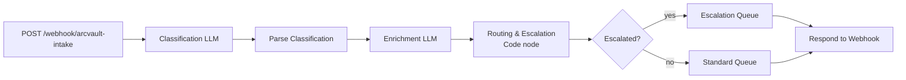

# ArcVault Intake & Triage Pipeline

An AI-powered n8n workflow that classifies, enriches, routes, and escalates inbound customer requests.

Support teams receive unstructured messages from email, web forms, and support portals, and someone has to read each one to decide where it goes. This pipeline takes a raw message over a webhook, uses an LLM to classify it and pull out the key details, then applies deterministic rules to route it to the right queue or flag it for human review. The routing and escalation logic lives in code rather than in the model, so the rules stay predictable and auditable.

## Features

- **Webhook ingestion**: a `POST` endpoint accepts a request `id`, `source`, and `message`.
- **LLM classification**: assigns a category (`Bug Report`, `Feature Request`, `Billing Issue`, `Technical Question`, `Incident/Outage`), a priority (`Low` / `Medium` / `High`), and a 0–100 confidence score.
- **LLM enrichment**: extracts a one-sentence core issue, identifiers (account URLs, invoice numbers, error codes), an urgency signal (`Critical` / `Urgent` / `Normal` / `Low`), and a 2–3 sentence summary for the team that receives it.
- **Deterministic routing**: a lookup table maps categories to queues (Engineering, Product, Billing, IT/Security). Unknown categories, or confidence below 70, fall back to `General/Triage`.
- **Escalation rules**: a request is flagged if any of these apply:
  - confidence is below 70
  - the message contains an escalation keyword (e.g. "outage", "security breach", "multiple users affected")
  - it is a billing issue with a dollar-amount discrepancy over $500
- **Conditional output**: escalated records go to an escalation queue and all other records go to their standard queue. The caller receives a JSON response with the destination and the escalation status.
- **Defensive parsing**: strips markdown fences from LLM output before parsing the JSON.

## Tech Stack

| Layer | Technology |
|---|---|
| Orchestration | n8n (self-hosted) |
| LLM | Groq API, `llama-3.3-70b-versatile` (temperature 0.1, JSON-only prompts) |
| Logic | n8n Code nodes (JavaScript) |
| Output | Webhook.site (stands in for downstream queues) |

## Architecture



- **Stateless and linear**: each node reads earlier node outputs through n8n's expression context. There is no external state store.
- **Separate LLM calls**: classification and enrichment run as separate calls, so a failed enrichment does not lose a valid classification.
- **Rules in code**: routing and escalation are plain JavaScript, not prompts, so they are deterministic.

### Output record

Each processed request produces a record like the following (see [`processed_requests.json`](processed_requests.json) for five full examples):

```json
{
  "request_id": 1,
  "source": "Email",
  "original_message": "...",
  "timestamp": "2026-03-13T23:05:00.000Z",
  "classification": { "category": "Bug Report", "priority": "Medium", "confidence_score": 90 },
  "enrichment": { "core_issue": "...", "identifiers": ["..."], "urgency_signal": "Urgent" },
  "routing": { "destination_queue": "Engineering", "routing_reason": "Category 'Bug Report' maps to Engineering" },
  "escalation": { "escalation_flag": false, "escalation_reasons": [] },
  "summary": "..."
}
```

## Getting Started

### Prerequisites

- Node.js and npm (to install n8n)
- A [Groq](https://groq.com) API key
- A [Webhook.site](https://webhook.site) URL, or any HTTP endpoint you want records delivered to

### Run

1. Install and start n8n:
   ```bash
   npm install -g n8n
   n8n start
   ```
2. In n8n, import [`ArcVault Intake & Triage Pipeline.json`](ArcVault%20Intake%20%26%20Triage%20Pipeline.json).
3. Add your Groq API key in **both** LLM nodes, *Step 2 — Classification* and *Step 3 — Enrichment*. Replace `YOUR_GROQ_API_KEY_HERE` in the `Authorization` header.
4. Set your Webhook.site URL (or your own endpoint) in both output nodes, *Step 5a — Escalation Queue* and *Step 5b — Standard Queue*.
5. Activate the workflow and send `POST` requests to the webhook:
   ```bash
   curl -X POST http://localhost:5678/webhook/arcvault-intake \
     -H "Content-Type: application/json" \
     -d '{"id": 1, "source": "Email", "message": "Hi, I keep getting a 403 error when logging in."}'
   ```
   The response looks like `{"status":"processed","request_id":1,"destination":"Engineering","escalated":false}`.

> The example uses n8n's default local port (5678) and production webhook path. Use the test URL shown in the n8n editor if you are running the workflow in test mode.

## Repository Contents

| File | Purpose |
|---|---|
| `ArcVault Intake & Triage Pipeline.json` | Importable n8n workflow |
| `processed_requests.json` | Structured output for five sample requests |
| `Architecture_WriteUp_and_Prompt_Documentation.docx` | System design, routing and escalation rationale, prompt documentation, scaling notes |

---

Built by [Chadi Choker](https://github.com/ChadiChoker) · [Portfolio](https://github.com/ChadiChoker/portfolio)
